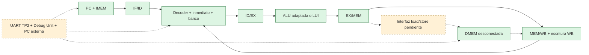

# TP3 — Procesador educativo: etapas 1 y 2

Las **etapas 1 y 2 están completadas en simulación RTL**. Hay bloques reutilizables
y un pipeline aritmético ejecutable de cinco etapas, con pruebas automáticas.
La explicación de la nueva entrega está en el **[README de etapa 2](README_etapa_2.md)**:
recorrido por ciclos, pausa/reset, dependencias, carga provisional y lectura de trazas.
El objetivo final es un procesador de 32 bits con pipeline de cinco
etapas, memorias separadas y una Debug Unit por UART que permita programar,
ejecutar y observar el estado desde una PC.

Se implementa el subconjunto de la consigna, no RV32I completo. El decoder
reconoce sus 32 instrucciones y la convención educativa HALT. El núcleo de etapa 2
ejecuta las 20 operaciones R/I aritméticas y LUI, con dependencias suficientemente
separadas. Reconocer una carga o un salto no significa ejecutarlo. No hay forwarding, control de
saltos, RUN/STEP, loader, protocolo UART nuevo ni aplicación del procesador.

| Etapa de desarrollo | Estado |
|---|---|
| 1. Diseño, adaptación de ALU y bloques básicos | Completada: 5 bancos, 6.637 comprobaciones aprobadas |
| 2. Pipeline aritmético | Completada: 15.380 comprobaciones, traza por ciclo y regresión de etapa 1 aprobada |
| 3. Memoria y dependencias de datos | Pendiente |
| 4. Saltos, paso a paso y parada | Pendiente |
| 5. UART, Debug Unit y aplicación | Pendiente |
| 6. Validación del sistema en FPGA | Pendiente |

Estas seis etapas de desarrollo no son las cinco etapas IF/ID/EX/MEM/WB del
pipeline. El [plan completo](docs/plan_etapas.md) fija la aceptación de cada una.

## Archivos y dependencias

```text
TP3/
  .gitignore                     excluye build y caches de Python
  README.md                      punto de entrada
  README_etapa_2.md               explicación del pipeline integrado y su uso
  rtl/
    tp3_defs.vh                  códigos internos comunes
    alu_adapter.v                instancia ALU TP1 + SLL/SLT/SLTU
    decoder.v                    campos y control de todo el subconjunto
    immediate.v                  inmediatos I/S/B/U/J y shamt
    register_file.v              x0..x31, bypass y lectura debug
    state.v                      PC y registro genérico con valid
    imem.v                       memoria reprogramable por puerto lógico
    dmem.v                       memoria con máscara de bytes y debug
    core.v                       núcleo aritmético IF/ID/EX/MEM/WB
    arithmetic_system.v          IMEM + núcleo, carga lógica de laboratorio
  tb/
    check.vh                     assertions y timeout común
    alu_tb.v                     aritmética adaptada
    decode_tb.v                  decoder, inmediatos e integración combinacional
    register_file_tb.v           banco completo y bypass
    state_tb.v                   PC y registros de 7/73 bits
    memory_tb.v                  IMEM/DMEM, profundidades 1/3/256
    pipeline_tb.v                secuencias aritméticas, pausa/reset y traza
  scripts/simulate.py            compilación/simulación y resultados
  docs/
    arquitectura.md              diagrama, puertos, controles y buses futuros
    decisiones.md                fuentes, inventario y elecciones justificadas
    plan_etapas.md               seis etapas y criterios de aceptación
    verificacion_etapa_1.md       evidencia y límites de la validación
    verificacion_etapa_2.md       cobertura y resultados de la integración
  build/                         generado e ignorado: logs, vvp, results.json
```

Única dependencia RTL externa: [`TP1/src/alu.v`](../TP1/src/alu.v). Se instancia
`alu #(.N_DATA(32), .N_OP(6))`; los archivos anteriores permanecen sin cambios.
TP1 aporta ADD/SUB/AND/OR/XOR/SRL/SRA. El adaptador convierte el código de
operación y limita el desplazamiento a `b[4:0]`. Agrega solamente SLL, SLT signed
y SLTU unsigned. ADD/SUB son modulares de 32 bits. NOR no se utiliza y LUI usa
selección de inmediato, sin inventar otra operación de ALU.

Se inspeccionaron RX, TX, baud, reset, interfaces y tests de TP2. RX entrega
`rx_data/rx_valid_pulse/frame_error`; TX recibe `tx_data/tx_start_pulse` y expone
`tx_busy/tx_done_pulse`. Baud entrega `tick_16x` con configuración de 100 MHz y
9600 baud. Su integración queda para etapa 5: el protocolo y la calculadora de
TP2 aún no controlan TP3. Hay otra definición `alu` en `TP2/src/alu.v`; el script
de TP3 no la compila ni incluye tops/testbenches de los trabajos anteriores.
El inventario de interfaces reales está en [decisiones](docs/decisiones.md).

## Cómo se relacionan los bloques



Verde: bloques implementados. Flechas continuas: integración de etapa 2.
Naranja y flechas punteadas: subsistemas/conexiones pendientes (la UART existe
en TP2 y DMEM está probada como bloque, pero no están conectadas al núcleo).
Las cuatro instancias concretas del registro genérico ya forman el pipeline.
El [diagrama y contratos detallados](docs/arquitectura.md) incluyen debug y saltos.

El **PC** almacena la dirección de búsqueda; recibe `next_pc` y solo cambia con
enable o reset en un flanco positivo. Arranca en cero al resetear, parametrizable.
La integración de etapa 2 ya calcula PC+4; el selector de saltos sigue pendiente.

El **decoder** transforma los bits de la instrucción en campos y controles.
`uses_rs1/uses_rs2` indican qué fuentes realmente se necesitan: los bits de un
inmediato no son una dependencia de rs2. Una codificación no soportada activa
`illegal` y desactiva todas las escrituras y clasificaciones.

El **generador de inmediatos** reconstruye I/S/B/U/J y extiende el signo.
B/J ya incluyen el bit cero inferior. Los inmediatos lógicos y SLTIU también
se extienden con signo; luego SLTIU compara sin signo. `shamt` es un puerto
separado de cinco bits. El adaptador usa esos mismos cinco bits bajos de B.

El **banco** tiene dos lecturas de operandos, una escritura y una lectura de
debug. x0 siempre vale cero, x31 es general. El bypass permite a ID ver el dato
que WB está por escribir. Debug muestra el dato almacenado hasta el flanco.
Reset síncrono limpia todos los registros y desactiva bypass mientras está alto.

**Valid** distingue una instrucción real de una burbuja. **Enable** permite
capturar el siguiente estado; sin él se mantiene. **Flush** limpia datos y valid,
con prioridad sobre enable. Reset tiene prioridad máxima. Son registros por
flanco, no latches transparentes. El núcleo ya condiciona la escritura del banco
por enable y valid. Los flush están inactivos en etapa 2; al agregar saltos deben
condicionarse por el avance global. Las escrituras futuras de DMEM también deben
respetar pausa y validez. Pausar solo los registros intermedios no alcanzaría.

## Control por familia

Definiciones reales: [`rtl/tp3_defs.vh`](rtl/tp3_defs.vh), implementadas por
[`rtl/decoder.v`](rtl/decoder.v). RW/MR/MW significan escritura de registro,
lectura de memoria y escritura de memoria, antes de aplicar valid/enable.

| Instrucciones | Fuentes | Inmediato | Resultado WB | RW/MR/MW |
|---|---|---|---|---|
| add/sub/sll/srl/sra/and/or/xor/slt/sltu | rs1, rs2 | Ninguno | ALU | 1/0/0 |
| addi/andi/ori/xori/slti/sltiu/slli/srli/srai | rs1 | I | ALU | 1/0/0 |
| lb/lh/lw/lbu/lhu | rs1 | I | Memoria | 1/1/0 |
| sb/sh/sw | rs1, rs2 | S | No escribe | 0/0/1 |
| beq/bne | rs1, rs2 | B | No escribe | 0/0/0 |
| jal | Ninguna | J | PC+4 | 1/0/0 |
| jalr | rs1 | I | PC+4 | 1/0/0 |
| lui | Ninguna | U | Inmediato | 1/0/0 |
| HALT / ilegal | Ninguna | Ninguno | No escribe | 0/0/0 |

La tabla describe el decoder completo; el núcleo actual admite solo R/I
aritméticas y LUI. Las demás activan diagnóstico y se invalidan después de ID,
sin parada automática. La [tabla completa](docs/arquitectura.md#controles-del-decoder) especifica
selectores, ALU, tamaño signed/unsigned y clasificación de saltos. Solo la palabra
**`0x00100073` (EBREAK)** activa `is_halt`. HALT es un alias educativo propuesto,
no una instrucción HALT estándar. ECALL es ilegal en este subconjunto. El
ensamblador llegará en etapa 5 y la lógica de parada/drenaje en etapa 4.

## Memorias y reloj

IMEM y DMEM son independientes, cada una con `DEPTH_WORDS=256` (1 KiB).
Todas las direcciones externas son bytes de 32 bits y deben estar alineadas a
cuatro; los arrays internos se indexan en palabras. Se soportan profundidades
positivas no potencia de dos. El rango se valida antes de indexar, incluidos
bits altos, evitando alias silenciosos. Se reportan rango y alineación por puerto;
una lectura inválida devuelve cero con error y una escritura inválida se ignora.

Las lecturas son combinacionales; las escrituras ocurren en posedge con enable.
IMEM ofrece carga de palabras desde testbench ahora, loader UART después.
El wrapper aritmético acepta esa carga solo con núcleo deshabilitado, pipeline
vacío, reset inactivo y dirección válida; reset conserva IMEM.
DMEM ofrece máscara de cuatro bytes y un puerto debug independiente. El bit 0
de máscara modifica bits 7:0: es little-endian. Máscara 0000 no escribe. La
selección/extensión de loads y el desplazamiento de stores pertenecen a etapa 3.

Las RAM no se borran por reset. Una posición válida aún no escrita contiene
datos indeterminados, no cero. En lectura/escritura simultánea se ve el dato
anterior antes del flanco y el nuevo después de asentarse; un consumidor que
capture en ese mismo flanco toma el anterior. No hay bypass de RAM. La intención
es RAM distribuida; una BRAM de lectura síncrona requeriría cambiar la latencia.

TP1/TP2 confirman Basys 3 y entrada de 100 MHz. TP3 conserva esa intención y
no crea clocks derivados; aún no existen top/XDC propios ni cierre de timing.
La futura UART y Debug Unit seguirán activas al pausar el núcleo.
Las políticas futuras de carga, limpieza, longitud de programa y watchdog están
en [decisiones](docs/decisiones.md#políticas-propuestas-para-integración-todavía-no-implementadas).

## Ejecutar las pruebas

Desde la raíz, en PowerShell o en un shell con Python 3:

```powershell
python TP3/scripts/simulate.py
python TP3/scripts/simulate.py --stage 2
python TP3/scripts/simulate.py --stage 1
python TP3/scripts/simulate.py --bench decode_tb
python TP3/scripts/simulate.py --list
```

Si Icarus no está en PATH, indicar ambos ejecutables. Por ejemplo, para la copia
local extraída durante esta implementación:

```powershell
python TP3/scripts/simulate.py --iverilog TP3/build/tools/icarus/app/bin/iverilog.exe --vvp TP3/build/tools/icarus/app/bin/vvp.exe
```

El script también detecta automáticamente esa copia local cuando no hay Icarus
en PATH. `build/` no se versiona: en otro equipo hay que disponer de Icarus o
pasar rutas propias. El script no instala ni descarga herramientas.

Compila Verilog con `-g2005 -Wall`, includes y tops explícitos y solamente las
fuentes necesarias para cada banco. `--list` imprime los comandos completos.
Resuelve el repositorio desde su propio archivo, sin depender del directorio
incidental. Cada fallo de compilación, assertion, timeout o herramienta ausente
produce salida distinta de cero; cada simulación debe además emitir su PASS.

El 07/10/2026 se ejecutó con Python 3.12 e Icarus **12.0 (devel),
s20150603-1539-g2693dd32b**, paquete Windows `iverilog-v12-20220611-x64_setup.exe`
extraído localmente sin ejecutar el instalador. Los cinco bancos pasaron:
ALU 66, decoder/inmediatos/integración 5.280, banco 229, estado 42 y memorias 1.020.
El 23/10/2026 se volvió a ejecutar esa regresión y se agregó el pipeline con
15.380 checks: **22.017 comprobaciones aprobadas en seis bancos**.
Los logs y `results.json` se generan en `TP3/build/`. Hay avisos informativos de
sensibilidad combinacional a arrays de RAM. No hay fallos de simulación pendientes.
El nuevo banco genera además `build/pipeline_trace.csv`. Los filtros `--stage` y
`--bench` usan archivos de resultados propios para conservar el resumen completo.
Ver los informes de [etapa 1](docs/verificacion_etapa_1.md) y
[etapa 2](docs/verificacion_etapa_2.md) para cobertura y límites.

No se ejecutaron Vivado, síntesis, implementación, UART física ni pruebas en
placa. Se ejecutan secuencias aritméticas de prueba, con NOP cuando hacen falta;
no programas del subconjunto completo ni mediciones de frecuencia máxima.

## Lecturas y siguiente entrega

El libro explica MIPS: sirve para entender lógica/estado, controles y pipeline,
pero la codificación y la semántica de instrucciones de TP3 son RISC-V.

| Tema | Página impresa | PDF recortado citado en el pedido (no disponible) | PDF completo encontrado |
|---|---|---|---|
| Lógica, sincronización, PC, banco y ALU | 303–310 | 6–13 | 328–335 |
| Control y decodificación | 316–323 | 19–26 | 341–348 |
| Registros intermedios | 346–348 | 49–51 | 371–373 |

Consigna: páginas 13–19, leída completa. Semántica contrastada con
[RISC-V RV32I oficial](https://docs.riscv.org/reference/isa/v20260120/unpriv/rv32.html).
Materiales inspeccionados y diferencias con la referencia se registran en
[decisiones](docs/decisiones.md).

La etapa 2 ya integra el pipeline aritmético con cuatro registros concretos,
fetch PC+4, selección ALU/LUI, destino y control viajando con cada instrucción,
trazas por ciclo y pruebas de pausa/reset. Sus anchos, sin valid, son
64/196/141/103 bits. El [README de etapa 2](README_etapa_2.md) explica los ciclos
y el bypass WB/ID con ejemplos. La etapa 3 conectará memoria y resolverá riesgos
de datos para quitar la necesidad de NOP manuales; sigue pendiente.
