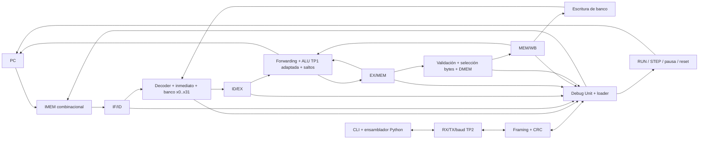

# TP3 — Procesador RISC-V educativo para Basys 3

Implementación del subconjunto solicitado, con pipeline IF/ID/EX/MEM/WB, carga de programas por UART, ejecución continua y por ciclos, y depuración desde Windows. **No implementa RV32I completo.** TP1 y TP2 se reutilizan sin modificaciones.

El núcleo, la aplicación, el protocolo y el top están implementados. La evidencia actual y los resultados de síntesis, implementación y timing se registran en [verificación final](docs/verificacion_final.md). Las evidencias de etapas 1 y 2 conservan sus fechas y alcance históricos. Una simulación no acredita funcionamiento físico: la primera prueba en placa se describe abajo.

## Primera ejecución en Windows

Abrir PowerShell en la raíz del repositorio. Instalar Python 3.10 o superior, Vivado con soporte Artix-7 y los controladores USB de la placa. El ensamblador y las pruebas Python no necesitan paquetes externos; la comunicación física requiere pyserial:

```powershell
py -m pip install -r TP3/pc/requirements.txt
py TP3/pc/tp3.py assemble TP3/programs/demo.asm
py -m unittest discover -s TP3/scripts -p test_host.py -v
py TP3/scripts/regress.py
```

Si Vivado no está en PATH, `regress.py` busca instalaciones habituales o acepta `--vivado-bin "C:/ruta/Vivado/bin"`. Icarus sigue siendo una alternativa para la batería histórica: `py TP3/scripts/simulate.py`, con `--iverilog` y `--vvp` si hace falta. El runner nuevo usa xvlog/xelab/xsim para todos los bancos, compila el RTL como Verilog y los testbenches como SystemVerilog para que `$fatal` sea efectivo. Todos los fallos/timeouts producen código de salida no cero.

Desde una consola con `vivado` en PATH, generar el diseño completo:

```powershell
vivado -mode batch -source TP3/scripts/build.tcl -log TP3/build/vivado.log -journal TP3/build/vivado.jou
```

Si sólo se quiere crear el proyecto para abrirlo en la GUI:

```powershell
vivado -mode batch -source TP3/scripts/build.tcl -tclargs project
```

El proyecto es `TP3/build/vivado/project/tp3.xpr`; top `tp3_basys3_top`, parte `xc7a35tcpg236-1`. El flujo completo ejecuta síntesis, placement, routing, DRC y reportes de setup/hold/CDC/caminos sin restricciones. No escribe el bitstream si setup o hold tienen slack negativo. La salida es `TP3/build/vivado/tp3.bit`.

Conectar la Basys 3 por su micro-USB **PROG/UART**, encenderla y programarla:

```powershell
vivado -mode batch -source TP3/scripts/program.tcl
py TP3/pc/tp3.py ports
```

`program.tcl` exige exactamente un dispositivo xc7a35t y programa SRAM por JTAG. No modifica la flash. Reemplazar COM5 por el puerto enumerado y cerrar otros terminales seriales:

```powershell
py TP3/pc/tp3.py --port COM5 --baud 9600 status
py TP3/pc/tp3.py --port COM5 load TP3/programs/demo.asm
py TP3/pc/tp3.py --port COM5 run --wait
py TP3/pc/tp3.py --port COM5 snapshot --used-memory
py TP3/pc/tp3.py --port COM5 memory 0 4
```

El primer programa es:

```asm
addi x1, x0, 7
addi x2, x1, 5
sw   x2, 0(x0)
lw   x3, 0(x0)
add  x4, x3, x1
halt
```

**Esperados:** estado `finalizado`, causa `HALT`, valid de los cuatro registros intermedios en cero; x0=0, x1=7, x2=12, x3=12, **x4=19 (0x00000013)**, x31=0. En dirección 0, bytes `0c 00 00 00`, palabra 12. Memoria utilizada: 0..3, ambos extremos incluidos. No se insertan NOP.

Para repetir por ciclos:

```powershell
py TP3/pc/tp3.py --port COM5 restart
py TP3/pc/tp3.py --port COM5 step
py TP3/pc/tp3.py --port COM5 step --count 4
py TP3/pc/tp3.py --port COM5 snapshot
py TP3/pc/tp3.py --port COM5 run --wait
```

Cada STEP avanza **un ciclo**, no una instrucción. `--count` envía esa cantidad de órdenes y falla si se intenta avanzar más allá de un estado terminal. `snapshot` y `memory` pausan el núcleo y lo dejan pausado; `status` permite consultar el estado sin pausar. `run --wait` consulta STATUS hasta terminar y devuelve error del proceso si el núcleo terminó por error. Su timeout de espera no cancela RUN: usar `pause` si se desea cancelar la espera y detener el avance.

## Arquitectura



Cinco etapas reales y cuatro registros intermedios con `valid` independiente. El PC de cada instrucción viaja con ella. MEM accede a DMEM y WB escribe el resultado final; varias instrucciones se superponen. No hay ejecución simulada en Python ni valores precalculados en debug.

```text
TP3/
  rtl/
    processor.v        núcleo completo: pipeline, riesgos, control y memorias
    decoder.v          único decoder del subconjunto, existente
    immediate.v        inmediatos I/S/B/U/J, existente
    alu_adapter.v      adaptación de la ALU TP1, existente
    register_file.v     32 registros, x0 fijo y bypass WB/ID, existente
    imem.v / dmem.v     RAM distribuida de lectura combinacional, existentes
    packet.v           parser/serializer, escape, CRC y timeout
    debug.v            comandos, carga, captura de estado y respuestas
    system.v           interconexión de UART TP2, debug y procesador
    basys3_top.v        reset, sincronizadores, antirrebote y display
    core.v             núcleo aritmético HISTÓRICO de etapa 2
    arithmetic_system.v wrapper HISTÓRICO de laboratorio
    state.v            bloques históricos de PC/pipeline
    tp3_defs.vh        constantes y anchos de buses
  pc/
    assembler.py       ensamblador de una pasada de etiquetas + emisión
    protocol.py        framing y CRC compatibles con RTL
    snapshot.py        schema y presentación completa de pipeline/registros
    tp3.py             CLI y cliente serial
    requirements.txt   pyserial 3.5
  programs/            demo.asm, loop.asm, bytes.asm, error.asm
  constraints/basys3.xdc
  scripts/
    sources.tcl        lista explícita de fuentes sintetizables
    build.tcl          proyecto, síntesis, implementación, reportes y bitstream
    program.tcl        programación JTAG
    regress.py         regresión acumulada con xsim
    simulate.py        runner Icarus histórico
    test_cases.py      programas y esperados independientes del RTL
    uart_vectors.py    tramas PC y verificación de respuestas seriales RTL
    test_host.py       pruebas Python
  tb/                  bancos históricos + processor/uart_system/board_tb
  docs/                protocolo, matriz, decisiones y evidencias
  build/               generado e ignorado por Git
```

`core.v` y `arithmetic_system.v` permanecen para reproducir las pruebas originales. **No se usan en el top final ni se sintetizan.** El núcleo nuevo reutiliza decoder, inmediato, adaptador ALU, banco y memorias reales. Se instancia exclusivamente `TP1/src/alu.v`, a 32 bits; nunca `TP2/src/alu.v`. Se reutilizan `uart_rx`, `uart_tx`, `baud_rate_generator` y `reset_sync` de TP2. Las FSM de la calculadora de TP2 no son un loader y no se incorporan.

## Instrucciones y ensamblador

| Familia | Instrucciones |
|---|---|
| R | ADD SUB SLL SRL SRA AND OR XOR SLT SLTU |
| I | ADDI ANDI ORI XORI SLTI SLTIU SLLI SRLI SRAI |
| Loads | LB LH LW LBU LHU |
| Stores | SB SH SW |
| Control | BEQ BNE JAL JALR |
| Superior | LUI |
| Convención del proyecto | HALT = EBREAK exacto `0x00100073` |

Registros `x0`..`x31`, sin alias ABI ni registro reservado. Operandos separados por comas; enteros decimales o `0x`/`0b`/`0o`, con signo cuando corresponde. Etiquetas `nombre:` en línea propia o antes de una instrucción. Comentarios `#` o `;`. No hay directivas, instrucciones comprimidas, relocaciones ni expansiones ocultas.

`nop` emite exactamente `addi x0,x0,0`; `halt` emite EBREAK. Son los únicos alias. JAL requiere `jal rd, etiqueta` o desplazamiento numérico en bytes. Branch numérico también es relativo al PC de la propia instrucción. `jalr rd, inmediato(rs1)`; loads/stores usan la misma sintaxis de dirección. LUI recibe el campo **unsigned de 20 bits**, no el valor de 32 bits ya desplazado. El ensamblador valida registros, aridad, rangos, shamt 0..31, alineación de destinos y etiquetas; los errores indican línea. Las direcciones de datos calculadas en ejecución se validan en hardware.

ADD/SUB desbordan modularmente. Los inmediatos I se extienden con signo, incluso en SLTIU y operaciones lógicas; SLTIU compara luego sin signo. Los shifts R usan cinco bits del desplazamiento. Branch tomado usa `PC + inmediato`; JAL además escribe `PC+4`; JALR calcula `(rs1+inmediato)&~1`, escribe `PC+4` y comprueba alineación a cuatro. No se usa rd como fuente del salto ni PC+4 como base de branch.

| Programa | Resultados principales |
|---|---|
| demo.asm | x1=7, x2=x3=12, x4=19, palabra DMEM[0]=12 |
| loop.asm | x2=15, x31=24, DMEM[4]=15, DMEM[0]=0 |
| bytes.asm | x2=ffffff80, x3=128, x5=ffffffff, x6=65535, x7=ffff8000 |
| error.asm | causa DMEM desalineada, x1=7, x2=x3=0, pipeline vacío |

## Reloj, memorias y pipeline

Un único reloj de **100 MHz**, entrada W5 y restricción de 10 ns. RUN/STEP son habilitaciones; no se usan botones ni compuertas como reloj. UART y display siguen funcionando durante una pausa. El reset lógico es síncrono, activo alto; en placa se sincroniza el botón y se aplica la liberación de TP2. El arranque de FPGA genera un reset inicial.

IMEM y DMEM tienen 256 palabras de 32 bits cada una (1 KiB). Lecturas combinacionales y escrituras en flanco positivo, sin cambiar la latencia de los bloques originales. Little-endian: el byte de dirección menor ocupa los bits 7:0. No se usan resets masivos de RAM; BEGIN y RESTART limpian DMEM secuencialmente, una palabra por ciclo, salvo la opción explícita de conservar datos. Un reset físico invalida el programa y limpia registros/pipeline, pero deja el contenido físico de RAM sin contrato hasta la siguiente carga.

Loads y stores validan la dirección original extendida a 33 bits y el extremo `dirección+tamaño` antes de alinear/indexar. LB/SB admiten cualquier byte; LH/LHU/SH requieren múltiplo de 2; LW/SW, múltiplo de 4. Un acceso inválido no lee un resultado arquitectónico ni escribe. SB/SH desplazan datos y máscaras, preservando los bytes vecinos. LB/LH extienden signo; LBU/LHU, ceros. El rango utilizado registra todos los bytes de **accesos exitosos**, inclusive loads; `used_valid=0` distingue ausencia de accesos.

Forwarding a ambas fuentes en EX: primero EX/MEM si es productor válido y no load, luego MEM/WB; x0 nunca recibe forwarding. El dato y la base de stores usan esos mismos operandos. Un load en EX que produce una fuente realmente usada en ID mantiene PC e IF/ID e inserta una burbuja en ID/EX, mientras MEM/WB avanzan. `uses_rs1/uses_rs2` evita falsos riesgos por bits de inmediato. WB/ID reutiliza el bypass del banco original.

Prioridades: reset/restart cancela escrituras; pausa mantiene estado; en un ciclo habilitado, error de MEM (más antiguo), parada/error de EX, drenaje, redirección de EX, stall, avance normal. Los saltos descartan IF/ID y la entrada joven de ID/EX. Los errores de fetch viajan como metadatos hasta EX; un salto anterior puede descartarlos. HALT e instrucciones ilegales también se resuelven en EX, evitando abortos especulativos. WB anterior y stores válidos de MEM se conservan frente a una parada en EX. Todos los efectos exigen valid y habilitación.

## Control y errores

| Estado | Código | Comportamiento |
|---|---:|---|
| Pausado | 0 | Mantiene PC, pipeline, banco y DMEM |
| Ejecutando | 1 | Un ciclo por flanco habilitado |
| Drenando | 2 | No busca instrucciones; termina las anteriores |
| Finalizado | 3 | HALT completado, pipeline vacío |
| Error | 4 | Causa observable, pipeline vacío |

El bit `running` indica si el drenaje avanza automáticamente. En modo STEP, un HALT entra en drenaje y hacen falta más STEP o RUN para completarlo; una pausa durante drenaje conserva estado 2 y pone running=0. `pipeline_empty` por sí solo **no** significa fin: también es cierto al inicio.

RUN continúa hasta HALT/error/watchdog. STEP avanza un ciclo incluso durante stall. PAUSE impide el siguiente avance una vez aceptada por el controlador; la recepción UART no detiene retrospectivamente el núcleo. HALT no escribe banco y suprime todas las jóvenes; las mayores completan antes del estado final. RESTART descarta todo lo pendiente y reinicia PC en `entry`, banco, contadores, causa y rango utilizado.

Causas: 0 ninguna; 1 HALT; 2 instrucción ilegal; 3 fetch fuera de longitud/rango o desalineado; 4 DMEM desalineada; 5 DMEM fuera de rango; 6 salto desalineado; 7 watchdog. `fault_pc` identifica la instrucción que falla; para watchdog indica el PC de búsqueda al cancelar. Si alineación y rango de DMEM fallan juntos, se informa alineación.

El límite inicial es 1.000.000 ciclos habilitados, configurable con `limit N`; cero lo deshabilita. Cuenta ciclos con stall y drenaje, nunca pausa/comunicación. Se reinicia con BEGIN/COMMIT/RESTART. En el último ciclo permitido: un error preciso de MEM/EX o drenaje ya completado tiene prioridad; después el watchdog; después HALT, salto y stall. Al cancelar por watchdog se conservan el WB y store MEM válidos del propio flanco y los efectos previos, y se invalidan las instrucciones todavía en vuelo. Cambiar el límite a un valor menor al contador causa cancelación en el próximo ciclo habilitado. Los estados terminales requieren RESTART o una nueva carga.

```powershell
py TP3/pc/tp3.py --port COM5 pause
py TP3/pc/tp3.py --port COM5 limit 100000
py TP3/pc/tp3.py --port COM5 restart --preserve-data
```

## UART, carga y snapshots

UART 8N1, sin flow control, **9600 baud** por defecto. El parámetro `--baud` de la PC debe coincidir con el bitstream; no negocia el baud de la FPGA. El divisor TP2 es `floor(100000000/9600/16)=651`, baud real aproximado 9600,6.

El [protocolo completo](docs/protocolo.md) especifica framing, escape, CRC, comandos, estados, tamaños, timeout y formato binario de snapshot. Se permite una sola solicitud pendiente. El cliente espera respuesta antes de transmitir la siguiente; no reintenta automáticamente STEP/RUN/cargas ante una respuesta perdida.

La carga usa BEGIN(longitud,entrada,conservar), DATA(offset,palabras) y COMMIT. BEGIN sólo se acepta detenido y vacío, invalida el programa anterior y reinicia el estado. Los bloques DATA deben ser consecutivos y completos. COMMIT valida que se recibieron todos los bytes; sólo entonces permite ejecutar. Una carga interrumpida deja `program_valid=0`. CRC incorrecto no modifica el programa ni ejecuta una orden. Si se pierde el ACK, consultar estado o reiniciar la carga; no asumir que la orden falló.

La longitud impide ejecutar palabras residuales al reemplazar un programa por uno más corto. Entrada y longitud son múltiplos de cuatro; `entry<longitud`. IMEM conserva físicamente el resto pero fetch fuera de longitud produce error, salvo que sea descartado por un salto anterior. No se ejecuta automáticamente tras cargar.

Snapshots: 256 bytes de datos, con schema `0x33545031`, 16 palabras de cabecera, los 32 registros y los cuatro buses completos de 64/196/141/103 bits. Los campos se presentan sin recortar: PC, instrucción, fuentes, destino, operandos, inmediato, controles y datos de memoria/WB. Valid y metadatos de error se transmiten por separado en la cabecera. Los bits de relleno de los buses son cero. STATUS anuncia schema y anchos; la aplicación rechaza versiones incompatibles antes de cargar. Un snapshot pausa antes de capturar; los botones quedan inhibidos durante captura y respuesta. No mezcla ciclos.

La salida de registros muestra hexadecimal, decimal unsigned y signed. Memoria muestra dirección, los cuatro bytes little-endian y ambas interpretaciones de la palabra. `snapshot --used-memory` alinea hacia afuera el rango observado para imprimir palabras completas y conserva en pantalla el rango exacto de bytes utilizados. Los huecos dentro del intervalo también aparecen. El timeout del cliente incluye el peor caso de escape, longitud máxima y baud; un snapshot a 9600 baud puede tardar una fracción significativa de segundo.

Para reprogramar sin resintetizar:

```powershell
py TP3/pc/tp3.py --port COM5 pause
py TP3/pc/tp3.py --port COM5 restart
py TP3/pc/tp3.py --port COM5 load TP3/programs/loop.asm
py TP3/pc/tp3.py --port COM5 run --wait
py TP3/pc/tp3.py --port COM5 snapshot --used-memory
```

Si el programa ya terminó con pipeline vacío, se puede cargar directamente. `--preserve-data` en LOAD o RESTART conserva explícitamente DMEM; por defecto se limpia. El banco siempre se limpia. La entrada del programa sigue siendo relativa a la IMEM cargada desde dirección cero.

## Controles locales y restricciones

| Control | Función / pin |
|---|---|
| btnC | Reset total del sistema, U18; requiere volver a cargar programa |
| btnU | STEP de un ciclo cuando está detenido, T18 |
| sw[4:0] | Índice x0..x31: V17 V16 W16 W17 W15 |
| sw[5] | 0 registro, 1 PC; V15 |
| sw[6] | 0 mitad baja, 1 mitad alta; W14 |
| led[3:0] | valid IF/ID, ID/EX, EX/MEM, MEM/WB |
| led[6:4] | Código de estado |
| led[7] | Programa válido |
| led[8] | Ejecución continua activa |
| led[9] | Debug/UART ocupado |
| led[15:10] | Causa de parada/error |
| seg[6:0], an[3:0], dp | Display hexadecimal, activo bajo; punto apagado |
| serial_rx / serial_tx | B18 / A18, LVCMOS33 |

Antirrebote: 10 ms de nivel estable, sincronización de dos flip-flops y un único pulso por flanco ascendente estable. Mantener el botón presionado no repite STEP. Soltarlo también debe superar el antirrebote. Los switches pasan por dos registros de sincronización. Los pulsos locales durante recepción de una trama, servicio de un comando, respuesta, RUN o estado terminal se descartan; no se encolan. Reset tiene prioridad global. Las órdenes UART aceptadas dominan al paso local.

Para observar x4=19: sw[4:0]=00100, sw5=0, sw6=0; display `0013`. sw6=1 muestra `0000`. El puerto de lectura del banco se comparte con debug durante transferencias; consultar el display con led9 apagado.

Asignación completa de pines en [basys3.xdc](constraints/basys3.xdc), contrastada con el [Master XDC oficial](https://raw.githubusercontent.com/Digilent/digilent-xdc/master/Basys-3-Master.xdc). Reloj, polaridad del display y conexión USB/JTAG/UART se contrastaron con el [manual oficial Digilent](https://reference.digilentinc.com/_media/reference/programmable-logic/basys-3/basys3_rm.pdf). El XDC antiguo de TP2 invierte los nombres RX/TX respecto del Master; TP3 usa la asignación oficial y conserva TP2 intacto.

Las excepciones temporales sólo cubren entradas asíncronas hacia su primer sincronizador y salidas humanas/UART sin receptor síncrono externo. Los caminos internos y entre etapas de sincronización siguen restringidos. No se rebaja el objetivo de reloj para ocultar errores. Los reportes distinguen retardo de datos, skew y slack.

## Verificación y solución de problemas

```powershell
py TP3/scripts/regress.py --bench processor_tb
py TP3/scripts/regress.py --bench uart_system_tb
py TP3/scripts/regress.py --bench board_tb
py TP3/scripts/regress.py --bench uart_baud_tb
py TP3/scripts/regress.py --bench pipeline_tb
```

Los esperados aritméticos son constantes independientes del decoder/ALU; se comprueban los 32 registros y toda DMEM después de cada programa, en RUN y STEP. La prueba UART genera tramas con el código Python de producción, transmite bits consecutivos por RX, decodifica los bits reales de TX y analiza snapshots con el decoder de producción. Los timeouts son fallos; los mocks no sustituyen RX/TX. El test de placa simula rebotes, pulsación sostenida y reset. Ver [matriz de requisitos](docs/matriz.md) y [evidencia final](docs/verificacion_final.md).

| Síntoma | Comprobación / solución |
|---|---|
| No aparece COM | Cable de datos, conector micro-USB PROG, alimentación y drivers; `ports` |
| Acceso denegado al puerto | Cerrar calculadora TP2, terminales seriales y otras instancias |
| Timeout UART | Bitstream TP3 correcto, baud 9600, RX B18/TX A18; esperar fin de respuesta antes de otra orden |
| Programa inválido | Carga incompleta o reset físico; repetir LOAD completo |
| Carga rechazada como ocupada | PAUSE y RESTART para vaciar pipeline, luego LOAD |
| STEP no termina una instrucción | STEP avanza un ciclo; revisar valid, stall y drenaje |
| Drenando detenido | RUN o más STEP; la pausa no completa las mayores por sí sola |
| Causa fetch | Falta HALT, salto fuera de longitud o entrada errónea |
| Causa DMEM | Dirección en bytes, tamaño/alineación y rango 0..1023 |
| Watchdog | Revisar bucle o aumentar `limit` antes de RUN; `restart` reinicia contador |
| Schema incompatible | Aplicación y bitstream de versiones distintas; reconstruir/programar ambos |
| Vivado no genera .bit | Revisar logs, DRC, setup/hold y caminos sin restricciones en build/vivado |

La prueba física restante debe registrar versión/bitstream, puerto/baud, resultados de los cuatro ejemplos, reprogramación más corta, paso local sostenido y comparación RUN/STEP. No se deduce esa evidencia de una simulación ni de un bitstream generado.
