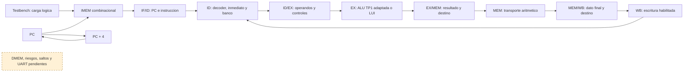

# Etapa 2 — Pipeline aritmético de cinco etapas

**Estado: completada en simulación RTL el 23/10/2026.** El procesador ya puede
ejecutar secuencias de operaciones aritméticas con varias instrucciones en vuelo.
La prueba integrada pasó 15.380 comprobaciones; la regresión completa de etapas
1 y 2 pasó 22.017. No se sintetizó ni se probó este núcleo en FPGA.

Esta entrega integra los bloques de etapa 1. Ejecuta diez operaciones R, nueve
inmediatas aritméticas y LUI. Las cargas, stores, saltos, HALT operativo, forwarding,
detector de riesgos, UART y Debug Unit permanecen pendientes. Los programas de
prueba separan las dependencias cercanas con NOP; el hardware aún no las detecta.

## Archivos de esta etapa

| Archivo | Función |
|---|---|
| [`rtl/core.v`](rtl/core.v) | `tp3_core`: PC, IF/ID, ID/EX, EX/MEM, MEM/WB, decoder, inmediato, banco, ALU y escritura WB. IMEM está fuera del núcleo. |
| [`rtl/arithmetic_system.v`](rtl/arithmetic_system.v) | `tp3_arithmetic_system`: conecta IMEM combinacional al núcleo y expone un puerto lógico de carga para simulación. Es integración de laboratorio, no top de Basys 3. |
| [`rtl/tp3_defs.vh`](rtl/tp3_defs.vh) | Agrega los anchos de los cuatro buses compartidos: 64/196/141/103 bits, más valid separado. |
| [`tb/pipeline_tb.v`](tb/pipeline_tb.v) | Carga palabras de prueba, aplica ciclos, compara el estado contra un modelo independiente y genera la traza. |
| [`scripts/simulate.py`](scripts/simulate.py) | Incorpora el nuevo banco, selección `--stage` y ruta absoluta de la traza. |
| [`docs/verificacion_etapa_2.md`](docs/verificacion_etapa_2.md) | Resultados, cobertura y limitaciones de la prueba. |

Los bloques de etapa 1 se reutilizan sin cambiar su comportamiento. En particular,
la ALU sigue instanciando `TP1/src/alu.v` a 32 bits mediante el adaptador existente.
TP1 y TP2 permanecen intactos; la UART todavía no participa.

## Qué hace cada etapa de hardware



Todas las flechas continuas están conectadas en esta entrega. Se usa el mismo
reloj para todos los elementos; `core_enable` es una habilitación, no otro reloj.

1. **IF:** PC direcciona IMEM. Si se solicita una búsqueda válida y el núcleo
   avanza, IF/ID captura `{PC, instrucción}` y PC se incrementa en cuatro bytes.
2. **ID:** el decoder identifica la operación y las fuentes; el banco entrega dos
   operandos y el generador reconstruye el inmediato. ID/EX captura estos datos,
   el destino y los controles de esa misma instrucción.
3. **EX:** selecciona los operandos y calcula. R usa rs1/rs2; I usa rs1/inmediato.
   LUI selecciona directamente el inmediato U. EX/MEM registra el resultado.
4. **MEM:** para estas operaciones no accede a memoria de datos. Transporta el
   resultado y el destino hacia MEM/WB. Mantener esta etapa conserva el diseño
   de cinco etapas que más adelante incorporará loads/stores.
5. **WB:** escribe `MEM/WB.write_data` en `MEM/WB.rd` si la entrada es válida,
   solicita escritura, rd no es cero, no hay reset y el núcleo está habilitado.

El destino y los controles deben viajar con el resultado. Tomar el rd de la
instrucción que en ese momento está en ID escribiría en el registro de una
instrucción más joven. La prueba comprueba esta correspondencia en cada ciclo.

## Un ejemplo por ciclos

Supongamos tres instrucciones independientes A, B y C. La tabla muestra el
trabajo combinacional **antes** del flanco que termina cada ciclo:

| Ciclo habilitado | IF | ID | EX | MEM | WB |
|---|---|---|---|---|---|
| 1 | A | — | — | — | — |
| 2 | B | A | — | — | — |
| 3 | C | B | A | — | — |
| 4 | sin búsqueda | C | B | A | — |
| 5 | sin búsqueda | — | C | B | A |
| 6 | sin búsqueda | — | — | C | B |
| 7 | sin búsqueda | — | — | — | C |

A se escribe al terminar el ciclo 5 y C al terminar el 7. La primera instrucción
necesita cinco ciclos; luego pueden completarse instrucciones consecutivas en
flancos consecutivos. Para N instrucciones admitidas consecutivamente desde
pipeline vacío, hacen falta N+4 ciclos habilitados, sin pausas. Los ciclos de
carga de IMEM y reset no forman parte de esa cuenta.

`valid=0` representa una burbuja. No obliga a que los bits de datos sean cero:
pueden contener información vieja o irrelevante. Nunca se permite escribir por
el solo hecho de que un control guardado sea uno; también se exige valid.
Un NOP real (`addi x0,x0,0`, palabra `0x00000013`) sí es una instrucción válida
que atraviesa las etapas. La palabra cero es ilegal, no un NOP.

## Pausa, reset y búsquedas

| reset | core_enable | fetch_enable | Efecto en el flanco |
|---|---|---|---|
| 1 | cualquiera | cualquiera | PC vuelve a RESET_PC, banco se limpia y los cuatro registros se vacían. IMEM se conserva. |
| 0 | 0 | cualquiera | PC, todos los campos del pipeline y el banco se mantienen; WB no escribe. |
| 0 | 1 | 1, dirección válida | Avanza el pipeline, admite instrucción y PC suma 4. |
| 0 | 1 | 0 | PC se mantiene; entra una burbuja en IF/ID y las instrucciones anteriores avanzan. |
| 0 | 1 | 1, dirección inválida | PC se mantiene, `fetch_error=1`, entra una burbuja y las anteriores avanzan. |

La expresión de escritura es:

```verilog
wb_write_enable = !reset && core_enable && wb_valid && wb_reg_write && (wb_rd != 0);
```

`fetch_enable` es una entrada provisional del laboratorio. El testbench sabe
cuántas palabras cargó y la baja después de admitirlas. Cuatro ciclos habilitados
adicionales permiten completar la última instrucción y vaciar los registros.
Esto no es HALT ni un controlador RUN/STEP: no hay estados de ejecución,
longitud almacenada, watchdog de hardware ni reconocimiento operativo de parada.
`pipeline_empty` solo indica que los cuatro bits valid valen cero; no significa
que el programa terminó. Puede estar vacío antes de empezar o entre búsquedas.

`fetch_valid` describe la oferta de IF; puede estar alto durante una pausa.
La admisión efectiva ocurre únicamente en un flanco con `core_enable=1`.
Los controles externos deben ser síncronos y estables alrededor de ese flanco.

## Dependencias: qué funciona y qué todavía no

No hay forwarding EX/MEM→EX ni MEM/WB→EX, ni stalls automáticos. Una instrucción
que lea demasiado pronto puede capturar el valor anterior del registro.
No se debe interpretar un resultado correcto de operaciones independientes como
soporte general de dependencias.

El banco de etapa 1 sí tiene **bypass WB→ID**. Cuando WB está por escribir un
registro, sus lecturas de operandos entregan ese dato en el mismo ciclo. Por eso,
en este pipeline, dos instrucciones separadoras son suficientes entre productor
y consumidor; tres NOP también son una elección conservadora.

```asm
addi x1, x0, 9
addi x0, x0, 0     # NOP 1
addi x0, x0, 0     # NOP 2
addi x2, x1, 1     # ID coincide con WB del productor: x2 = 10
```

La prueba pausa justamente con ese WB pendiente y el consumidor en ID. Mientras
está pausado, no se escribe ni se captura el consumidor. Al reanudar se activa
el bypass y se capturan los operandos correctos. El puerto debug muestra siempre
el almacenamiento, por lo que no adelanta una escritura todavía no realizada.
Los NOP manuales son una limitación transitoria de esta etapa; la etapa 3 deberá
eliminarlos de los programas finales mediante resolución de riesgos por hardware.

## Instrucciones ejecutadas

| Familia | Operaciones | Dato que llega a WB |
|---|---|---|
| R | add, sub, sll, srl, sra, and, or, xor, slt, sltu | Resultado de la ALU |
| I aritmética | addi, andi, ori, xori, slti, sltiu, slli, srli, srai | Resultado de la ALU con inmediato |
| U | lui | Inmediato con doce ceros inferiores |

Son 20 instrucciones, no RV32I completo. Las sumas/restas conservan los 32 bits
bajos. Los desplazamientos usan cinco bits. SLT/SRA usan signo; SLTU compara
sin signo. Los inmediatos I, incluso los lógicos y SLTIU, se extienden con signo.

El decoder sigue reconociendo todo el subconjunto de la consigna. El núcleo
solo admite en EX las operaciones de esta tabla. Una instrucción ilegal activa
`decode_illegal`; una reconocida pero aún no ejecutable (load/store/branch/JAL/
JALR/HALT) activa `decode_unsupported`. Ambas se convierten en burbuja al salir
de ID y no producen efectos. Se expone la causa, pero **no existe aún parada
por error**: la búsqueda secuencial continúa. Los diagnósticos son niveles
combinacionales asociados a ID, no eventos almacenados, y pueden persistir al pausar.
El testbench rechaza estos casos salvo en su prueba negativa específica.

## Carga y puertos de observación

`tp3_core` recibe `instruction[31:0]` e `instruction_error` para su salida `pc`.
`tp3_arithmetic_system` conecta esa interfaz a `tp3_imem`, con
`IMEM_DEPTH_WORDS=256` por defecto y `RESET_PC=0`. La prueba usa 128 palabras.

El puerto `load_enable/load_addr/load_data` escribe palabras en posedge;
`load_addr` expresa bytes alineados a cuatro. `load_accepted` indica aceptación
en ese flanco y `load_rejected` indica rechazo. Solo se acepta si no hay reset,
el núcleo no avanza, el pipeline está vacío y la dirección es válida. Es una
protección combinacional de la interfaz de laboratorio, sin protocolo ni loader.
La prueba carga palabras desde Verilog; aún no hay ensamblador de usuario ni
programación por UART. Reset no borra ni recarga IMEM.

Todos los campos de los registros están disponibles por salidas de solo lectura:

| Puerto | Ancho | Información |
|---|---|---|
| `debug_if_id` | 64 | PC e instrucción |
| `debug_id_ex` | 196 | PC/instrucción, fuentes/destino, operandos, inmediato y controles |
| `debug_ex_mem` | 141 | PC/instrucción, destino, resultado, dato de store y controles previstos |
| `debug_mem_wb` | 103 | PC/instrucción, destino, dato final, reg_write y HALT previsto |
| `pipeline_valid` | 4 | Bits 0/1/2/3: ID/EX/MEM/WB respectivamente |
| `debug_reg_addr` / `debug_reg_data` | 5 / 32 | Lectura almacenada de cualquiera de los 32 registros |
| `wb_pc/wb_instruction/wb_rd/wb_data/wb_write_enable` | 32/32/5/32/1 | Escritura que ocurrirá en el próximo flanco si enable sigue activo |

Los anchos y el orden completo de concatenación se detallan en
[arquitectura](docs/arquitectura.md#buses-concretos-del-pipeline).
Se conservaron los campos previstos para memoria/saltos para preparar la próxima
integración. En instrucciones válidas de esta etapa sus controles no están
activos. Un payload inválido puede contener controles no cero: valid sigue
siendo obligatorio. DMEM permanece como bloque probado y desconectado.

## Ejecutar y leer las pruebas

Desde la raíz del repositorio:

```powershell
python TP3/scripts/simulate.py --stage 2
python TP3/scripts/simulate.py --stage 1
python TP3/scripts/simulate.py
python TP3/scripts/simulate.py --bench pipeline_tb --list
```

Se requiere Python 3 e Icarus (`iverilog` y `vvp`). El runner detecta PATH o la
copia local de `TP3/build/tools/icarus/app/bin/`; también acepta rutas mediante
`--iverilog` y `--vvp`. Los comandos resuelven sus rutas desde el script y no
dependen del directorio de trabajo. No descargan herramientas.

El runner produce `build/pipeline_tb_compile.log`, `build/pipeline_tb.log` y
`build/pipeline_trace.csv`. La ejecución completa escribe `build/results.json`;
una ejecución filtrada escribe `results_stage_2.json`, `results_stage_1.json` o
`results_pipeline_tb.json` sin sobrescribir el resumen completo. Las fallas,
timeout y herramientas ausentes devuelven código distinto de cero.

La traza CSV registra el estado **antes** del flanco indicado por `edge`. Incluye
reset/enable, PC y validez de IF, PC/instrucción/valid de ID/EX/MEM/WB y escritura
WB. Los valores de PC, instrucciones y datos están en hexadecimal; rd en decimal.
`WB_write=1` describe la escritura que se realizará en ese flanco. El contador
`edge` enumera los flancos ejercitados por la tarea de prueba, incluidos pausa y
reset; no cuenta los flancos empleados para cargar IMEM. Ignorar campos de una
etapa cuyo valid sea cero.

Ejemplo real del primer programa (flancos 2–6, tras reset):

| edge | IF PC | ID PC | EX PC | MEM PC | WB PC | Escritura WB |
|---|---|---|---|---|---|---|
| 2 | 0x00 | — | — | — | — | — |
| 3 | 0x04 | 0x00 | — | — | — | — |
| 4 | 0x08 | 0x04 | 0x00 | — | — | — |
| 5 | 0x0c | 0x08 | 0x04 | 0x00 | — | — |
| 6 | 0x10 | 0x0c | 0x08 | 0x04 | 0x00 | x1 ← 7 |

La comparación automática no se limita a la traza: tras cada flanco de prueba
lee los 32 registros y compara contra un scoreboard con resultados literales.
También verifica la identidad de cada instrucción en cada etapa y todos los
bits retenidos durante pausa. Hay watchdog de simulación y timeout de proceso.

## Qué sigue

La etapa 3 conectará DMEM, alineación/extensión de cargas y stores, forwarding
hacia EX y detección load-use. Los índices de fuentes, `uses_rs1/uses_rs2`, el
resultado de EX/MEM y el dato de MEM/WB ya están disponibles para esa integración.
Todavía no se usa esa información para resolver dependencias.

Lecturas recomendadas: libro MIPS, páginas impresas 330–336, 345–350 y 354–363;
PDF recortado citado en el pedido: 33–39, 48–53 y 57–66. En el libro completo
local corresponden a 355–361, 370–375 y 379–388. La organización del pipeline
sirve como fundamento; las codificaciones e inmediatos de este proyecto son RISC-V.
