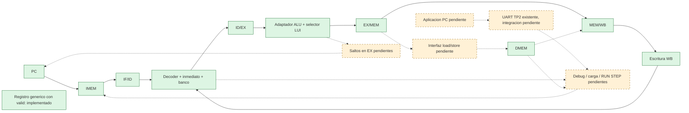

# Arquitectura y contratos — etapas 1 y 2

El sistema previsto es un subconjunto educativo de RV32I, con cinco etapas de
hardware. Las seis etapas **de desarrollo** están en [el plan](plan_etapas.md).
La etapa 2 conecta el pipeline aritmético. Las flechas continuas son conexiones
implementadas; las punteadas corresponden a funciones futuras. Para seguir una
instrucción por ciclos, ver [README de etapa 2](../README_etapa_2.md).

Verde: bloques implementados. Naranja: integración o subsistema pendiente
(la UART ya existe en TP2). Los cuatro registros concretos ya están conectados.
MEM transporta resultados aritméticos; DMEM aún no se conecta. El wrapper de
laboratorio `tp3_arithmetic_system` es RTL sintetizable, pero no hay top ni XDC
de placa propios, ni evidencia de síntesis/temporización de TP3.

## Reglas comunes

Datos/instrucciones/PC de 32 bits. Un único reloj, inicialmente 100 MHz según
`TP2/src/tp2_top.v` y su XDC de 10 ns para Basys 3. Escrituras en `posedge`.
Reset lógico síncrono activo alto; memorias sin reset. No se genera reloj nuevo.
Las direcciones de memoria son **bytes sin signo**, los índices internos palabras.
Todos los puertos combinacionales tienen latencia de cero ciclos, con retardo
físico aún sin medir. Las entradas deben estabilizarse antes del flanco activo.

## Contratos de bloques

| Archivo / módulo `tp3_…` | Entradas | Salidas | Estado, responsable futuro |
|---|---|---|---|
| `alu_adapter.v` / `alu_adapter` | a,b:32; alu_op:4 | result:32; zero:1 | Combinacional. EX selecciona operandos; op inválida devuelve cero. |
| `decoder.v` / `decoder` | instruction:32 | Campos y controles de la tabla inferior | Combinacional, único decoder en ID. No ejecuta instrucciones. |
| `immediate.v` / `immediate` | instruction:32; imm_type:3 | immediate:32; shamt:5 | Combinacional; ID. shamt=bits 24:20, separado del inmediato I completo. |
| `register_file.v` / `register_file` | clk,reset,write_enable:1; rs1,rs2,rd,debug_addr:5; write_data:32 | read_data1,read_data2,debug_data:32 | Escritura WB síncrona, lecturas ID/debug combinacionales. Reset borra 32 registros. |
| `state.v` / `pc` | clk,reset,enable:1; next_pc:32 | pc:32 | Parámetro RESET_PC=0. Reset > enable > hold. IF calcula PC+4; redirección futura. |
| `state.v` / `pipeline_register` | clk,reset,flush,enable,valid_in:1; data_in:WIDTH | valid_out:1; data_out:WIDTH | WIDTH positivo, predeterminado 32. Reset > flush > enable > hold. |
| `imem.v` / `imem` | clk,load_enable:1; fetch_addr,load_addr,load_data:32 | instruction:32; fetch_range_error,fetch_align_error,load_range_error,load_align_error:1 | Carga en posedge. IF lee; testbench escribe a través del wrapper, loader futuro. |
| `dmem.v` / `dmem` | clk,write_enable:1; addr,write_data,debug_addr:32; byte_enable:4 | read_data,debug_data:32; range_error,align_error,debug_range_error,debug_align_error:1 | MEM accede; Debug Unit futura lee. Escritura en posedge. |

Banco: x0 devuelve cero y rechaza escritura; x31 es general. El bypass de WB hacia
ambas lecturas exige `write_enable && !reset && rd!=0` y coincidencia de índice.
Debug siempre muestra almacenamiento, nunca el bypass. Durante reset, antes del
flanco, las lecturas siguen mostrando almacenamiento previo; el bypass está
desactivado. Después del flanco, todos los registros son cero.

El registro genérico captura incluso los datos de una entrada inválida: `valid=0`
los vuelve irrelevantes. Reset/flush sí ponen datos y valid a cero. Es un conjunto
de flip-flops, no un latch transparente. En la integración se usará
`flush_local = core_enable && flush_request`, para que flush no rompa una pausa.
La escritura WB ya incluye `core_enable && valid && control`, reset inactivo
y rd distinto de cero. Los stores futuros también exigirán habilitación y valid.
Un stall load-use futuro mantendrá PC/IF-ID, vaciará ID-EX y dejará avanzar los
mayores. Reset explícito puede modificar estado estando pausado.

## Controles del decoder

Las codificaciones internas están en `rtl/tp3_defs.vh`, distintas de opcode y
funct. Extrae opcode:7, rd:5, funct3:3, rs1:5, rs2:5, funct7:7 directamente.
Controles: illegal, uses_rs1, uses_rs2, reg_write, mem_read, mem_write, is_halt
(1 bit cada uno); alu_op:4; src_a:2 (RS1/PC/ZERO); src_b_imm:1;
imm_type:3 (NONE/I/S/B/U/J); wb_sel:2 (EX/MEM/PC4/IMM);
mem_size:2 (BYTE/HALF/WORD), load_unsigned:1; branch_type:3
(NONE/BEQ/BNE/JAL/JALR). Los tamaños no usados valen WORD.

| Familia | rs1/rs2 usados | A / B | ALU | Inmediato | WB | RW/MR/MW | Branch/HALT |
|---|---|---|---|---|---|---|---|
| R (10 operaciones) | 1/1 | RS1 / RS2 | Según funct3/funct7 | NONE | EX | 1/0/0 | NONE/0 |
| I aritmética (9) | 1/0 | RS1 / IMM | Según funct3; funct7 solo shifts | I | EX | 1/0/0 | NONE/0 |
| LB/LH/LW/LBU/LHU | 1/0 | RS1 / IMM | ADD | I | MEM | 1/1/0 | NONE/0 |
| SB/SH/SW | 1/1 | RS1 / IMM | ADD | S | EX | 0/0/1 | NONE/0 |
| BEQ/BNE | 1/1 | PC / IMM | ADD (destino) | B | EX | 0/0/0 | BEQ/BNE, 0 |
| JAL | 0/0 | PC / IMM | ADD (destino) | J | PC4 | 1/0/0 | JAL/0 |
| JALR | 1/0 | RS1 / IMM | ADD (destino bruto) | I | PC4 | 1/0/0 | JALR/0 |
| LUI | 0/0 | ZERO / IMM | ADD (no consumido) | U | IMM | 1/0/0 | NONE/0 |
| EBREAK exacto | 0/0 | RS1 / RS2 | ADD (no consumido) | NONE | EX | 0/0/0 | NONE/1 |
| Ilegal | 0/0 | RS1 / RS2 | ADD (no consumido) | NONE | EX | 0/0/0 | NONE/0 |

`illegal=0` en todas las familias legales. Las cargas signed usan BYTE/HALF/WORD;
LBU/LHU activan load_unsigned. Stores usan tamaño pero load_unsigned=0.
Una instrucción ilegal restablece **todos** los controles al estado seguro.
Los campos extraídos siguen reflejando sus bits aunque no sean fuentes reales.
La comparación BEQ/BNE futura usa operandos por separado del sumador de destino.
JALR futuro limpia bit 0 y verifica alineación a 4; JAL escribe PC+4 en rd.

## Memorias

DEPTH_WORDS=256; SIZE_BYTES=4*DEPTH_WORDS=1024. Se admite profundidad positiva
hasta 2^30 palabras, incluidas no potencias de dos. INDEX_BITS=max(1,clog2(depth)).
La comprobación de rango usa la dirección completa extendida a 33 bits antes
de indexar. Se rechazan índices que caben en el bus pero exceden la profundidad.
Todos los puertos, incluso debug y carga, exigen dirección alineada a 4.
Los errores de rango/alineación son combinacionales e independientes de enables;
el consumidor solo los atiende cuando solicita un acceso. Pueden activarse juntos.
Una lectura inválida devuelve cero **con error**; una escritura inválida se ignora.

Contenido válido sin escribir: indeterminado (X en simulación), no cero. No hay
reset de RAM ni inicializador. Antes del flanco una lectura concurrente ve el
valor almacenado anterior; después de la actualización y asentamiento ve el nuevo.
Otro flip-flop que captura en ese mismo flanco toma el valor anterior. No existe
bypass de memoria. Esto debe respetarse para snapshots y carga detenida.

DMEM tiene cuatro carriles de byte: bit i de byte_enable modifica bits 8*i +: 8;
el byte de menor dirección está en bits 7:0 (little-endian). Máscara 0000 conserva
todo. El puerto de datos comparte dirección entre lectura/escritura; debug es
independiente. La interfaz de etapa 3 verificará alineación del acceso original,
alineará la dirección de palabra, desplazará stores y extenderá loads. No están
implementadas esas funciones aquí. El atributo distributed expresa la intención;
la inferencia real y el cierre a 100 MHz requieren Vivado en etapa 6. BRAM síncrona
exigiría cambios de latencia y control.

## Buses concretos del pipeline

Implementados en `rtl/core.v`, con anchos en `rtl/tp3_defs.vh`. `valid` es un bit
separado del parámetro WIDTH. La tabla enumera los campos de mayor a menor peso,
en el mismo orden de las concatenaciones del RTL. PC+4 para enlaces se calculará
a partir del PC de la instrucción cuando se integren saltos. No se transportan
funct3/funct7 ni imm_type después de ID. Los campos para memoria/saltos se
conservan como preparación; no se ejecutan esas funciones en etapa 2.

| Registro | Campos de datos y control | WIDTH / con valid |
|---|---|---|
| IF/ID | PC:32, instruction:32 | 64 / 65 |
| ID/EX | PC:32, instruction:32, rs1/rs2/rd:5 cada uno, operand1/operand2/immediate:32 cada uno, uses_rs1/uses_rs2:1 cada uno, alu_op:4, src_a:2, src_b_imm:1, reg_write/mem_read/mem_write:1 cada uno, wb_sel:2, mem_size:2, load_unsigned:1, branch_type:3, is_halt:1 | 196 / 197 |
| EX/MEM | PC:32, instruction:32, rd:5, result:32, store_data:32, reg_write/mem_read/mem_write:1 cada uno, mem_size:2, load_unsigned:1, wb_from_mem:1, is_halt:1 | 141 / 142 |
| MEM/WB | PC:32, instruction:32, rd:5, write_data:32, reg_write:1, is_halt:1 | 103 / 104 |

Suma ID/EX: 160+15+2+4+2+1+3+2+2+1+3+1=196.
Suma EX/MEM: 128+5+3+2+1+1+1=141. MEM/WB: 96+5+1+1=103.

| Campos | Se consumen en | Se conservan para |
|---|---|---|
| PC e instruction | ID decodifica; EX calcula PC+4/destinos | Debug en los cuatro registros |
| rs1/rs2, uses y operandos | EX (forwarding futuro); detección temprana en ID | rs2 también aporta store_data |
| inmediato, ALU, selectores, branch | EX | result unifica ALU/LUI/enlace; destino de salto no viaja a MEM |
| mem_read/write, tamaño, unsigned, store_data | MEM | wb_from_mem elige resultado de carga |
| rd, reg_write | forwarding futuro y WB | Escritura final condicionada por valid/enable |
| is_halt, valid | Control etapa 4 | Drenaje y observabilidad; no efectos de burbujas |

Las instrucciones ilegales se detectan en ID (`decode_illegal`); las reconocidas
pero fuera del alcance aritmético activan `decode_unsupported`. En ambos casos
ID/EX recibe valid=0. Por ahora se continúa buscando secuencialmente y se expone
el diagnóstico, sin controlador de error ni excepción. En una integración futura
deberá descartarse un error de un camino especulativo invalidado por un salto
anterior. No hay redirecciones ni flush de control en esta etapa.

## Interfaces integradas en etapa 2

`tp3_core` tiene `clk/reset/core_enable/fetch_enable` de un bit, instrucción de
32 bits e `instruction_error` como entradas. Su salida `pc` direcciona una IMEM
combinacional externa. RESET_PC es parametrizable y vale cero por defecto.
`fetch_enable=0` mantiene PC e inserta burbujas si core_enable=1; no pausa las
instrucciones mayores. No hay control de longitud dentro del núcleo.

`tp3_arithmetic_system` instancia el núcleo y la IMEM, parametrizada por
IMEM_DEPTH_WORDS=256. El puerto lógico `load_enable/load_addr/load_data` conserva
el contrato de palabras y direcciones en bytes de IMEM. Sus salidas
load_accepted/load_rejected describen la operación en el siguiente posedge;
aceptar requiere `!reset && !core_enable && pipeline_empty` y dirección válida.
load_range_error/load_align_error y fetch_range_error/fetch_align_error se exponen
por separado. Fetch erróneo mantiene PC e inserta burbujas, reportando fetch_error
mientras exista solicitud. Estas señales no son estados de un controlador.

Ambos módulos exponen debug_reg_addr:5 → debug_reg_data:32; PC; los cuatro buses
anteriores; pipeline_valid:4 (bit 0 ID, 1 EX, 2 MEM, 3 WB); pipeline_empty; los
diagnósticos fetch_valid/fetch_error/decode_illegal/decode_unsupported; y
wb_pc/wb_instruction/wb_data:32, wb_rd:5, wb_write_enable:1. La escritura se
observa antes del flanco y el puerto debug refleja el almacenamiento posterior
al flanco. pipeline_empty es la reducción de los cuatro valid, no una bandera
de finalización de programa. No hay peticiones de memoria pendientes con esta
interfaz combinacional.
